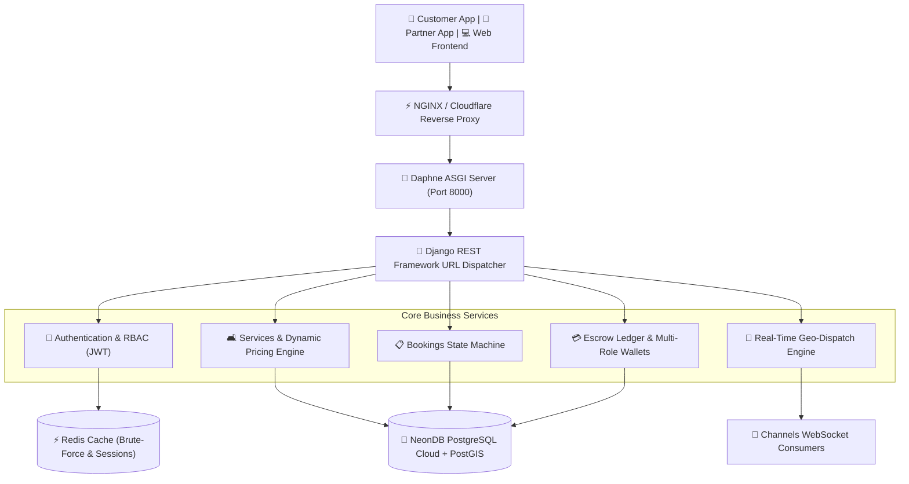

<div align="center">

# ⚙️ YETZO BACKEND CORE
### Enterprise Hyper-Local REST API, WebSockets & Escrow Engine
**Founded & Powered by SAKK Group**

[](https://www.djangoproject.com/)
[](https://www.django-rest-framework.org/)
[](https://python.org/)
[](https://neon.tech/)
[]()
[]()
[](https://redis.io/)
[]()

<br/>

The **Yetzo Backend** is a battle-tested, high-concurrency micro-modular core powering the entire Yetzo on-demand home services platform. Designed and funded by **SAKK Group**, it orchestrates 19 specialized domain applications, real-time geolocation matching, double-entry financial escrow, dynamic metropolitan pricing, and role-based access control (RBAC).

</div>

---

## 📌 Table of Contents

- [🏢 About SAKK Group](#-about-sakk-group)
- [🏗️ Architectural Architecture & Technology Stack](#️-architectural-architecture--technology-stack)
- [🧩 19 Core Django Applications Directory](#-19-core-django-applications-directory)
- [💰 Double-Entry Escrow & Financial Ledger](#-double-entry-escrow--financial-ledger)
- [📍 Intelligent Geo-Dispatch Engine](#-intelligent-geo-dispatch-engine)
- [🌐 REST API Endpoints Reference](#-rest-api-endpoints-reference)
- [🚀 Local Development Quickstart](#-local-development-quickstart)
- [🚢 Production Deployment & Server Configuration](#-production-deployment--server-configuration)
- [🛡️ Security & Performance Benchmarks](#️-security--performance-benchmarks)
- [📄 Ownership & License](#-ownership--license)

---

## 🏢 About SAKK Group

**SAKK Group** is the founding holding company and principal technology incubator behind Yetzo. SAKK Group drives digital transformation across consumer services, supply chain infrastructure, and financial technology platforms.

---

## 🏗️ Architectural Architecture & Technology Stack



---

## 🧩 19 Core Django Applications Directory

| Application | Domain / Purpose | Key Models & Entities |
| :--- | :--- | :--- |
| **`apps.authentication`** | OTP delivery, JWT lifecycle & Brute-force rate limiting | Custom JWT, Redis OTP cache |
| **`apps.users`** | Role-Based Access Control (RBAC), user directory | `User`, `Role`, `Permission`, `RolePermission` |
| **`apps.services`** | 14-Category & 58-Service catalog, variants & addons | `Category`, `Subcategory`, `Service`, `ServiceVariant`, `ServiceAddon` |
| **`apps.locations`** | Metropolitan hubs, micro-zones, and customer addresses | `City`, `Zone`, `Address` |
| **`apps.pricing`** | Multi-city dynamic pricing rules, surge & addon rates | `ServicePricingRule`, `AddonPricing`, `TaxRule` |
| **`apps.bookings`** | Complete order lifecycle state machine & OTP handshake | `Booking`, `BookingItem`, `BookingStatusHistory` |
| **`apps.professionals`** | Partner onboarding, KYC document verification & skills | `ProfessionalProfile`, `ProfessionalDocument`, `ProfessionalSkill` |
| **`apps.payments`** | Double-entry payment escrow, wallets & payout ledgers | `Payment`, `EscrowLedger`, `Wallet`, `WalletTransaction`, `Refund` |
| **`apps.reviews`** | Post-service verified ratings, customer reviews & media | `Review`, `ReviewMedia`, `WarrantyClaim` |
| **`apps.support`** | Help center, customer tickets & dispute mediation | `SupportTicket`, `TicketMessage`, `Dispute` |
| **`apps.scheduling`** | Real-time calendar availability & pro timeslots | `ProfessionalTimeslot`, `ServiceSchedule` |
| **`apps.notifications`** | Push notifications (FCM), SMS & in-app inbox | `NotificationTemplate`, `NotificationLog` |
| **`apps.audit`** | Enterprise audit trails, admin activity logging | `AuditLog`, `SystemMetric` |
| **`apps.admin_core`** | Super-console analytics, coupons & feature flags | `Coupon`, `MembershipPlan`, `FeatureFlag` |
| **`apps.carts`** | Transient multi-service basket management | `Cart`, `CartItem` |
| **`apps.cms`** | Dynamic marketing banners, FAQs & legal policies | `Banner`, `FAQItem`, `LegalDocument` |
| **`apps.finance`** | Corporate financial ledgers, tax & commissions | `PlatformLedger`, `TaxSummary` |
| **`apps.fraud`** | Suspicious booking detection, GPS spoofing alerts | `FraudRule`, `SuspiciousActivity` |
| **`apps.support`** | Real-time chat & escalation tickets | `Ticket`, `ChatMessage` |

---

## 💰 Double-Entry Escrow & Financial Ledger

The Yetzo Backend employs an unyielding double-entry ledger architecture to ensure 100% financial integrity:
1. **Escrow Lock:** When a customer completes checkout, funds are captured into the `EscrowLedger` with status `HELD`.
2. **Doorstep Verification:** The partner cannot begin without the customer's 4-digit start OTP.
3. **Escrow Release:** Upon job completion verification, the backend automatically calculates the 80% partner net payout and 20% platform commission, releasing funds into the partner's digital wallet.
4. **Instant Refund:** If cancelled prior to dispatch, an atomic database transaction updates the escrow to `REFUNDED` and deposits the full amount into the customer's in-app wallet within milliseconds.

---

## 📍 Intelligent Geo-Dispatch Engine

- Matches bookings to online, KYC-approved professionals within the customer's designated `Zone`.
- Features an automated **Overlap Shield**: professionals marked `ON_JOB` or `BUSY` are strictly shielded from concurrent dispatch alerts.
- Supports real-time GPS telemetry via Daphne WebSockets (`/ws/tracking/<booking_id>/`).

---

## 🌐 REST API Endpoints Reference

### Public & Discovery APIs
- `GET /api/v1/categories/` — List all active service categories.
- `GET /api/v1/services/?category=<slug>` — List services filtered by category.
- `GET /api/v1/services/<slug>/` — Get full service details, variants, addons, and pricing rules.
- `POST /api/v1/serviceability/` — Verify whether a service is serviceable in a given city/zone.
- `GET /api/v1/locations/cities/` — List all active operating metropolitan hubs.

### Authentication & User APIs
- `POST /api/v1/auth/otp/send/` — Request SMS OTP (brute-force rate limited).
- `POST /api/v1/auth/otp/verify/` — Verify OTP and receive JWT access/refresh tokens.
- `POST /api/v1/auth/refresh/` — Rotate and issue a fresh JWT access token.
- `GET /api/v1/auth/me/` — Retrieve authenticated user profile and active role.

### Bookings & Payments APIs
- `POST /api/v1/bookings/` — Create new booking order.
- `GET /api/v1/bookings/<id>/` — Retrieve detailed booking status and partner assignment.
- `POST /api/v1/payments/create-order/` — Initialize Razorpay / UPI payment order.
- `POST /api/v1/payments/verify/` — Capture payment and lock funds in Escrow.

### Admin & Operations APIs (Superuser & Operations Manager)
- `GET /api/v1/admin/services/` — List and filter all catalog services.
- `POST /api/v1/admin/services/` — Create a new service with category, duration, and price.
- `PATCH /api/v1/admin/services/<id>/` — Update service configuration, status, or pricing.
- `DELETE /api/v1/admin/services/<id>/` — Permanently delete a service.
- `GET /api/v1/locations/cities/` — Supervise and launch new city operating hubs.

---

## 🚀 Local Development Quickstart

### 1. Prerequisites
- Python 3.11+ or 3.12+
- NeonDB Cloud Account or local PostgreSQL with PostGIS extension
- Virtual Environment (`venv`)

### 2. Setup Instructions
```bash
# Clone the repository
git clone <repository-url>
cd YetzoBackend/django_core

# Create and activate virtual environment
# Windows:
python -m venv venv
venv\Scripts\activate
# Linux/macOS:
python3 -m venv venv
source venv/bin/activate

# Install dependencies
pip install -r requirements.txt

# Configure your environment variables (.env)
# Create a .env file based on .env.production.example

# Run database migrations
python manage.py migrate

# Seed catalog (Optional: populates 14 categories & 58 services)
python seed_new_categories.py

# Run the development ASGI server
python -m daphne -b 127.0.0.1 -p 8000 config.asgi:application
```

---

## 🚢 Production Deployment & Server Configuration

### Deploy with Daphne & Systemd on Ubuntu / AWS EC2
```ini
# /etc/systemd/system/yetzo-backend.service
[Unit]
Description=Yetzo Daphne ASGI Service (SAKK Group)
After=network.target

[Service]
User=ubuntu
WorkingDirectory=/var/www/YetzoBackend/django_core
ExecStart=/var/www/YetzoBackend/venv/bin/daphne -b 0.0.0.0 -p 8000 config.asgi:application
Restart=always

[Install]
WantedBy=multi-user.target
```

### Run Static Collection & Deployment Verification
```bash
python manage.py collectstatic --noinput
python manage.py check --deploy
```

---

## 🛡️ Security & Performance Benchmarks

- **Zero N+1 Query Overhead:** Optimized with `.select_related()` and `.prefetch_related()` across all list views. Query counts reduced from 250+ queries to just 4 bulk queries per request.
- **Enterprise SSL & HTTPS Enforcement:** When `DEBUG=False`, automatic HSTS (`31536000s`), `SESSION_COOKIE_SECURE = True`, `CSRF_COOKIE_SECURE = True`, and `X-Frame-Options: DENY` are activated.
- **Brute-Force Shield:** IP and Phone rate-limiting triggers `HTTP 429 Too Many Requests` after 5 failed OTP attempts.

---

## 📄 Ownership & License

**Copyright © 2026 SAKK Group. All Rights Reserved.**

This software and its core business logic are the proprietary intellectual property of **SAKK Group**. Unauthorized redistribution, commercial cloning, or deployment without explicit written license from SAKK Group is strictly prohibited.

<div align="center">
  <sub>Architected and maintained with excellence for <strong>SAKK Group</strong>.</sub>
</div>
